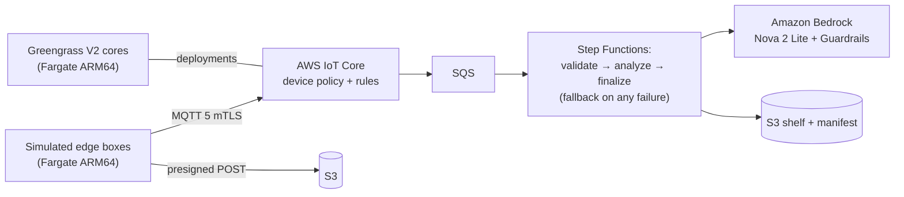

# Edge-to-Cloud Generative Image Pipeline

[中文说明](README.zh-CN.md)

> **Prototype — not for production.** This repository is a reference implementation for demonstration
> and learning. If you deploy or use it, you are responsible for the deployment, its use and the
> consequences. Work with your own security and legal teams to evaluate it before any use with real
> devices or data, following the [AWS Shared Responsibility Model](https://aws.amazon.com/compliance/shared-responsibility-model/).
> Use a disposable, non-production sandbox account. See the
> [hardening checklist](docs/handover.md#hardening-checklist-before-production) before going further.

Simulated edge boxes (in front of smart cameras) connect to AWS IoT Core with their own certificates,
upload product photos, and a serverless workflow uses a multimodal model on Amazon Bedrock to draft
e-commerce assets (a cropped shelf image and draft copy) that land on a "shelf" — S3 objects and a
manifest. The prototype focuses on three things:

1. **Many devices, stable connections** — per-device identity and isolation, fleet provisioning by
   claim, and a load test with a reconnect storm that reports connect success, reconnect time and
   message loss.
2. **Cloud-to-edge iteration** — staged rollouts with health checks, abort criteria and automatic
   rollback, drilled on AWS IoT Greengrass V2 cores and on AWS IoT Jobs simulators.
3. **A safe image pipeline** — image content and model output are untrusted; prompt injection through
   text in images is tested with a synthetic set, including a negative control.

Everything also runs offline in a local simulation mode (no AWS, no Docker, no broker process).

## Architecture



Details, trust boundaries, trade-offs and the fact check: [docs/architecture.md](docs/architecture.md).
Threats and controls: [THREAT_MODEL.md](THREAT_MODEL.md). Choices and alternatives: [DECISIONS.md](DECISIONS.md).

## Prerequisites and cost

- A non-production AWS account with permission to create the resources listed in [SECURITY.md](SECURITY.md),
  a CDK-bootstrapped region (default `us-east-1`), and access to the configured Bedrock model.
- Python 3.13 with [uv](https://docs.astral.sh/uv/), Node.js (for `npx aws-cdk@2`), AWS CLI v2. Docker is
  **not** needed: images are built by AWS CodeBuild on ARM, Lambda wheels are downloaded for aarch64.
- Cost dimensions (no free tier assumed; see each pricing page): AWS IoT Core connectivity minutes,
  messages, rules, Jobs and fleet provisioning ([pricing](https://aws.amazon.com/iot-core/pricing/));
  Greengrass core devices ([pricing](https://aws.amazon.com/greengrass/pricing/)); Amazon Bedrock model
  tokens and guardrail units ([pricing](https://aws.amazon.com/bedrock/pricing/)); Lambda, Step Functions
  state transitions, SQS, DynamoDB, S3, CloudWatch; Fargate vCPU/memory time
  ([pricing](https://aws.amazon.com/fargate/pricing/)); CodeBuild build minutes; ECR storage; Secrets Manager.
  The sandbox profile can create an AWS Budgets cost budget that notifies the alarm topic.

## Deploy

```bash
make init                         # uv sync; creates config/sandbox.json and config/handover.json from the examples
make preflight                    # read-only: confirms account (last 4 digits) and region, tools, services, quotas
make deploy                       # guarded cdk deploy + image build in CodeBuild
# Accounts that cannot create another VPC: USE_DEFAULT_VPC=1 make deploy (uses the default VPC's
# public subnets, changes nothing in that VPC)
```

`make deploy` refuses change sets that delete or replace resources unless `ALLOW_DESTRUCTIVE=1`.
Parameters and the profile differences are described in [docs/deployment-guide.md](docs/deployment-guide.md).

## Use and verify

```bash
make demo                                   # offline: D1-D6 in local simulation mode, prints a summary
ALLOW_PAID=1 make verify                    # cloud: identities, D1-D3, input checks, revocation, D6 injection set
ALLOW_PAID=1 make verify-rollout            # cloud: D4 on IoT Jobs simulators and on Greengrass cores
ALLOW_PAID=1 make verify-loadtest           # cloud: D5 reconnect storm sized from Service Quotas
```

| Scenario | What you see |
|---|---|
| D1 Device access | Devices provisioned by claim, connected, heartbeats routed, presence rows |
| D2 Shutter to shelf | Upload → workflow → shelf image, result file and manifest entry |
| D3 Cross-device attempt | Publish/subscribe on another device's topics refused; AuthError metric; revoked certificate refused |
| D4 Staged rollout and rollback | Broken release fails its health check on the first devices, rolls back, abort stops the rollout; good release completes |
| D5 Reconnect storm | Connect success rate, reconnect time distribution, message loss, for jitter vs immediate reconnect |
| D6 Prompt injection | Images with embedded instructions end on fallback or review; nothing injected is published |

The demo walkthrough (10- and 30-minute versions): [docs/demo-script.md](docs/demo-script.md). Results of
the runs made for this version: [VERIFICATION.md](VERIFICATION.md) and [DEPLOYMENT-LOG.md](DEPLOYMENT-LOG.md).

## Troubleshooting

| Symptom | Check |
|---|---|
| `make deploy` stops with "deletes or replaces resources" | Review the diff; re-run with `ALLOW_DESTRUCTIVE=1` only if intended |
| Stack fails with a VPC or internet-gateway limit | `USE_DEFAULT_VPC=1 make deploy` |
| IoT policy creation fails with a size error | The device policy must stay below the AWS IoT policy size limit (`tests/test_policy.py`) |
| Simulators fail provisioning | Claim certificate missing: `make identities`; hook denials: serial range vs `max_fleet_size` |
| Images end on fallback `model_error` | Model access or inference profile in the region (`make preflight`) |
| Greengrass cores never become HEALTHY | Log group `/<prefix>/ecs/greengrass`; core certificates (`make identities`) |
| Residual check lists resources | `make destroy` again; see [docs/cleanup.md](docs/cleanup.md) |

## Security and limitations

Controls and their implementation files are listed in [SECURITY.md](SECURITY.md); least-privilege
details and cdk-nag acknowledgements in [SECURITY-NOTES.md](SECURITY-NOTES.md). Main limitations: prompt
injection is reduced, not removed (one documented gap in the test set); the claim certificate is shared
by design; tasks run in public subnets without inbound rules; Greengrass on Fargate is not a
documented configuration (see VERIFICATION.md for what ran); load-test results describe one run, not
capacity.

## Clean up

```bash
make destroy           # removes things, certificates, jobs, Greengrass resources, tasks; destroys the stack; asks twice
make verify-cleanup    # read-only; exits non-zero if anything of this project remains
```

Not removed automatically by CloudFormation (the cleanup script handles them; verify afterwards):
IoT things and certificates, IoT jobs, Greengrass deployments, core devices and component versions,
log groups created by services (custom-resource handlers, Container Insights), secrets scheduled for
deletion, retained data (handover profile), and this project's objects in the CDK bootstrap assets
bucket. The CDK bootstrap stack itself is never touched. Do not assume a finished command means
everything is gone — run the residual check. Details: [docs/cleanup.md](docs/cleanup.md).

## Repository layout

```
src/edge_pipeline/      pipeline, policy, rules, validation, simulator, local mode
src/functions/          Lambda handlers (one bundle)
infra/                  CDK app (edge_infra/*) and parameter validation
config/                 parameter templates (sandbox, handover)
containers/             simulator and Greengrass images, CodeBuild buildspec
greengrass/             component artifacts (self-test)
scripts/                preflight, deploy, drills, load test, cleanup, residual check, demo
tests/                  unit, local-mode and CDK assertion tests
sample-data/            synthetic prompt-injection set manifest (images are generated)
docs/                   architecture, deployment, demo, handover, cleanup, prior art, standards review
```

## Local testing

```bash
make lint test synth eval    # ruff, pytest, cdk synth + cdk-nag (both profiles, no credentials), injection evaluation
make scan                    # gitleaks (history + canary), zizmor, osv-scanner
```

## Contributing

See [CONTRIBUTING.md](CONTRIBUTING.md).

## Security

See [SECURITY](SECURITY.md) for more information.

## License

This library is licensed under the MIT-0 License. See the [LICENSE](LICENSE) file.
