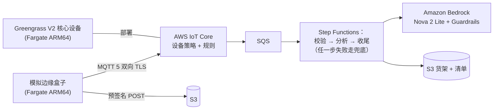

# 边缘到云生成式影像管线（Edge-to-Cloud Generative Image Pipeline）

[English](README.md)

> **Prototype，不用于生产。** 本仓库是用于演示和学习的参考实现。部署或使用本项目的一方，要对部署、
> 使用及其后果负责；在接入真实设备或数据之前，请与自己的安全和法务团队一起评估，并遵循
> [AWS 责任共担模型](https://aws.amazon.com/compliance/shared-responsibility-model/)。请使用可丢弃的非生产沙箱账号。
> 继续之前请先看[上生产前的加固清单](docs/handover.md#hardening-checklist-before-production)。

模拟的边缘盒子（连接智能相机）用各自的证书接入 AWS IoT Core，上传商品照片；无服务器工作流调用
Amazon Bedrock 上的多模态模型，生成电商素材（裁好的上架图和文案草稿），写入"货架"——S3 对象和清单文件。
原型聚焦三件事：

1. **海量设备的连接稳定性**：每设备身份与隔离、按声明（claim）的舰队预置、带重连风暴的压测，输出连接成功率、
   重连耗时和消息丢失率。
2. **云边协同迭代**：带健康检查、中止条件和自动回滚的分批发布，在 AWS IoT Greengrass V2 核心设备和
   AWS IoT Jobs 模拟器上分别演练。
3. **安全的图像管线**：图像内容和模型输出都视为不可信输入；用合成测试集检验"图中文字"式提示注入，含必须失败的反例。

全部流程也能在本地模拟模式下离线运行（不需要 AWS、Docker 或 MQTT broker 进程）。

## 架构



组件、信任边界、取舍与事实核对见 [docs/architecture.md](docs/architecture.md)；威胁与对策见
[THREAT_MODEL.md](THREAT_MODEL.md)；选型与备选见 [DECISIONS.md](DECISIONS.md)。

## 前置条件和成本

- 非生产 AWS 账号，具备创建 [SECURITY.md](SECURITY.md) 所列资源的权限；目标区域（默认 `us-east-1`）已做 CDK bootstrap；
  已开通所配置的 Bedrock 模型访问。
- Python 3.13 与 [uv](https://docs.astral.sh/uv/)、Node.js（用于 `npx aws-cdk@2`）、AWS CLI v2。**不需要** Docker：
  镜像在 ARM 架构的 AWS CodeBuild 中构建，Lambda 依赖直接下载 aarch64 wheel。
- 计费维度（不预设免费额度，以各定价页为准）：AWS IoT Core 连接分钟数、消息、规则、Jobs 与舰队预置
  （[定价](https://aws.amazon.com/iot-core/pricing/)）；Greengrass 核心设备（[定价](https://aws.amazon.com/greengrass/pricing/)）；
  Amazon Bedrock 模型 token 与 Guardrails 用量（[定价](https://aws.amazon.com/bedrock/pricing/)）；Lambda、Step Functions
  状态转换、SQS、DynamoDB、S3、CloudWatch；Fargate vCPU/内存时长（[定价](https://aws.amazon.com/fargate/pricing/)）；
  CodeBuild 构建分钟、ECR 存储、Secrets Manager。沙箱配置可创建 AWS Budgets 成本预算，通知到告警主题。

## 部署

部署命令见英文 README 的 [Deploy](README.md#deploy) 一节（命令只在一处维护）。要点：`make init` → `make preflight`
（只读，确认账号末 4 位与区域）→ `make deploy`（有删除/替换时默认拒绝，需显式 `ALLOW_DESTRUCTIVE=1`）。
账号无法再创建 VPC 时，用 `USE_DEFAULT_VPC=1 make deploy`（使用默认 VPC 的公有子网，不修改该 VPC）。
参数说明见 [docs/deployment-guide.md](docs/deployment-guide.md)。

## 使用和验证

| 场景 | 预期现象 |
|---|---|
| D1 设备接入 | 设备经 claim 预置后在线，心跳经规则路由，presence 表有记录 |
| D2 从快门到货架 | 上传 → 工作流 → 上架图、结果文件与清单条目 |
| D3 越权尝试 | 访问他人主题的发布/订阅被拒；AuthError 指标；吊销后的证书无法连接 |
| D4 分批发布与回滚 | 坏版本在首批设备健康检查失败并回滚，中止条件停止发布；好版本全部完成 |
| D5 重连风暴 | 连接成功率、重连耗时分布、消息丢失率，对比带抖动退避与立即重连 |
| D6 提示注入 | 嵌入指令的图像走兜底或人工审核，注入内容不会上架 |

离线演示：`make demo`；云上验证：`ALLOW_PAID=1 make verify`、`make verify-rollout`、`make verify-loadtest`。
演示脚本（10 分钟与 30 分钟版）见 [docs/demo-script.md](docs/demo-script.md)，本版本的实测结果见
[VERIFICATION.md](VERIFICATION.md) 与 [DEPLOYMENT-LOG.md](DEPLOYMENT-LOG.md)。

## 故障排查

见英文 README 的 [Troubleshooting](README.md#troubleshooting) 表：破坏性变更保护、VPC 配额、IoT 策略大小上限、
预置失败、模型访问、Greengrass 核心不健康、清理残留。

## 安全与局限

对策及实现文件见 [SECURITY.md](SECURITY.md)；最小权限细节与 cdk-nag 豁免见 [SECURITY-NOTES.md](SECURITY-NOTES.md)。
主要局限：提示注入只能降低、不能消除（测试集中有一条已记录的缺口）；claim 证书按设计为共享；任务运行在无入站规则的
公有子网；Greengrass 在 Fargate 上运行不在官方文档范围内（实际运行情况见 VERIFICATION.md）；压测结果只代表一次运行，
不代表容量。

## 清理

`make destroy`（先删 IoT 事物、证书、Jobs、Greengrass 资源与任务，再销毁栈，两次确认），然后 `make verify-cleanup`
（只读，有残留即非零退出）。CloudFormation 不会自动删除、由清理脚本处理的资源：IoT 事物与证书、IoT Jobs、Greengrass
部署/核心设备/组件版本、服务自动创建的日志组、计划删除中的密钥、保留的数据（交接配置）、本项目在 CDK bootstrap
资产桶中的对象。CDKToolkit 栈不动。不要以为命令跑完就删干净了，务必运行残留核对。详见 [docs/cleanup.md](docs/cleanup.md)。

## 目录结构

```
src/edge_pipeline/      管线、策略、规则、校验、模拟器、本地模式
src/functions/          Lambda 入口（同一个代码包）
infra/                  CDK 应用与参数校验
config/                 参数模板（sandbox、handover）
containers/             模拟器与 Greengrass 镜像、CodeBuild buildspec
greengrass/             组件制品（自检脚本）
scripts/                预检、部署、演练、压测、清理、残留核对、演示
tests/                  单元、本地模式与 CDK 断言测试
sample-data/            合成提示注入集清单（图像运行时生成）
docs/                   架构、部署、演示、交接、清理、prior-art、规范核对
```

## 本地测试

`make lint test synth eval`（ruff、pytest、两套配置的 cdk synth + cdk-nag（无需凭证）、注入评测）；`make scan`
（gitleaks 全历史 + canary、zizmor、osv-scanner）。

## Contributing

See [CONTRIBUTING.md](CONTRIBUTING.md).

## Security

See [SECURITY](SECURITY.md) for more information.

## License

This library is licensed under the MIT-0 License. See the [LICENSE](LICENSE) file.
