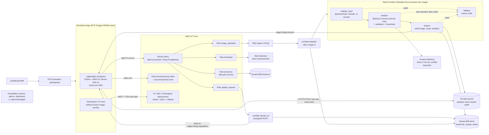

# Architecture

This document describes v0.1.0. The mermaid diagrams below are the source of truth (no rendered
images are kept). Deployment commands are in the README only.

## Components and data flow

| Component | Responsibility | Code |
|---|---|---|
| Device simulator | Heartbeats with sequence numbers and store-and-forward, image capture/upload, authorization probes, IoT Jobs agent with health check and local rollback | `src/edge_pipeline/simulator/` |
| Fleet provisioning | Claim certificate → own key pair and certificate per device; hook limits serial, fleet size, client id | `simulator/provisioning.py`, `functions/handlers.py`, `infra/edge_infra/iot.py` |
| Device policy | Own client id, own topics, own job topics only | `src/edge_pipeline/policy.py` |
| Rules | Topic identity must equal `clientid()`; SQS / Lambda / DynamoDB actions; error action queue | `src/edge_pipeline/rules.py` |
| Pipeline | Upload grants, dispatch, input checks, model call, validation, shelf, fallback | `src/edge_pipeline/pipeline.py` |
| Shelf | Crop on a plain canvas from the validated subject box; manifest with conditional writes | `src/edge_pipeline/shelf.py` |
| Greengrass | Nucleus in a container (manual provisioning); component `com.example.EdgeModel` with a start-up self-test | `containers/greengrass/`, `greengrass/`, `scripts/rollout_drill_gg.py` |
| Local mode | In-process broker with the same policy, rules, stand-ins for S3/DynamoDB/SQS/Step Functions/Jobs | `src/edge_pipeline/local/` |

## Trust boundaries

See [THREAT_MODEL.md](../THREAT_MODEL.md). In short: devices, image bytes, image text and model
output are untrusted; identity comes only from the TLS client certificate bound to a thing; object
keys are computed in code; the model has no side-effecting tools.

## Deployment topology

One CloudFormation stack in one region (default `us-east-1`). A VPC with two public subnets in two
fixed AZs, no NAT gateway, and a security group without inbound rules (egress 443 and 8883). Fargate
tasks are started on demand by the scripts (no long-running service) and stop at the end of each
drill. Lambda functions are not in the VPC. Images are built by an ARM CodeBuild project from a
staged source asset and tagged with the asset hash (immutable tags).

## Trade-offs

- **Presigned POST vs credentials provider for uploads.** The POST policy pins key, type and exact
  size, which the IAM-credential alternative cannot do; the cost is one MQTT round trip per image.
- **Deterministic shelf rendering.** No image-generation model is used; the model only proposes a
  subject box, validated before use. Visual quality is limited to crop and canvas.
- **Standard workflows.** Exactly-once and durable history fit per-image processing; they cost more
  per state transition than Express (see pricing page) — the trade is auditability.
- **Public subnets without NAT.** Cheaper and simpler for a sandbox; tasks have public IPs but no
  inbound path. Production would use private subnets with VPC endpoints.
- **Two rollout layers.** Greengrass gives the real component lifecycle; IoT Jobs on simulators shows
  the same rollout/abort semantics at larger device counts.

## Limits

- No real devices, cameras or e-commerce platform; the shelf is S3 objects and a manifest.
- The device policy must stay below the AWS IoT policy size limit (found in testing).
- Greengrass on Fargate is not a documented configuration; it ran in testing (T4), which does not make it supported.
- Load-test numbers describe one run in one account at one time; they are not capacity statements.
- The injection keyword rules are English/Chinese and not exhaustive; one known gap is in the test set.
- The Bedrock budget alarm is account-wide (no cost-allocation tags).

## Provisioning options compared

| Method | Fits when | Used here |
|---|---|---|
| Single thing / bulk registration with pre-created certificates | Certificates can be installed before delivery | Greengrass cores, revocation probe |
| Just-in-time provisioning/registration (JITP/JITR) | Devices carry certificates signed by your own CA; requires registering the CA in the account | No (account-level CA registration) |
| Fleet provisioning by trusted user | An installer app with credentials provisions on site with a short-lived claim | No (no installer in the scenario) |
| Fleet provisioning by claim | Unique certificates cannot be installed before delivery; a shared claim certificate plus a pre-provisioning hook | Simulators |

Revocation: set the certificate to `INACTIVE` (or `REVOKED`), which ends and refuses connections;
to remove it, detach policies and the thing, keep it inactive, then delete it (`scripts/cleanup_iot.py`).

## Region availability and differences

Default region: `us-east-1` (all services used are available there). Check other regions in the
[regional services list](https://aws.amazon.com/about-aws/global-infrastructure/regional-product-services/).
China regions differ: AWS IoT Core is offered in Beijing and Ningxia with documented feature
differences ([IoT in China](https://docs.amazonaws.cn/en_us/aws/latest/userguide/iot.html)); Greengrass
V2 is listed for Beijing only ([Greengrass V2 in China](https://docs.amazonaws.cn/en_us/aws/latest/userguide/greengrass-v2.html));
Amazon Bedrock does not appear in the China service list (only Bedrock AgentCore,
[AgentCore in China](https://docs.amazonaws.cn/en_us/aws/latest/userguide/bedrock-agentcore.html)), so
the generative step would need a different model hosting option there (OPEN-QUESTIONS Q2).
Nova 2 Lite is reachable from `us-east-1` only through the `us.`/`global.` inference profiles.

## Fact check

Verified against official documentation on **2026-10-21** unless marked "found in testing".

| # | Statement | Source |
|---|---|---|
| F1 | `${iot:Connection.Thing.ThingName}` resolves to the thing attached to the presented certificate; with non-exclusive attachment the client id must equal the thing name; `iot:Connection.Thing.IsAttached` requires an attached thing | [Thing policy variables](https://docs.aws.amazon.com/iot/latest/developerguide/thing-policy-variables.html) |
| F2 | Resource ARN types: `client/` for Connect, `topic/` for Publish/Receive, `topicfilter/` for Subscribe; `*` is the policy wildcard, MQTT `+`/`#` are literal | [IoT action resources](https://docs.aws.amazon.com/iot/latest/developerguide/iot-action-resources.html), [Greengrass device auth](https://docs.aws.amazon.com/greengrass/v2/developerguide/device-auth.html) |
| F3 | Thing policy variables are not supported in policies for Greengrass core devices; minimal core policy (client id suffix `*`, jobs/shadow topics, role alias, Greengrass actions) | [Greengrass device auth](https://docs.aws.amazon.com/greengrass/v2/developerguide/device-auth.html) |
| F4 | Rules SQL functions `topic(n)` and `clientid()`; actions SQS, Lambda, DynamoDBv2; error action | [SQL functions](https://docs.aws.amazon.com/iot/latest/developerguide/iot-sql-functions.html), [Rule actions](https://docs.aws.amazon.com/iot/latest/developerguide/iot-rule-actions.html), [Error handling](https://docs.aws.amazon.com/iot/latest/developerguide/rule-error-handling.html) |
| F5 | Lifecycle events on `$aws/events/presence/connected|disconnected/<clientId>` are on by default; disconnect events carry `disconnectReason` | [Lifecycle events](https://docs.aws.amazon.com/iot/latest/developerguide/life-cycle-events.html) |
| F6 | Fleet provisioning MQTT API (`$aws/certificates/create/json`, `$aws/provisioning-templates/<name>/provision/json`), template may reference an existing policy by name, pre-provisioning hook returns `allowProvisioning` | [Fleet provisioning API](https://docs.aws.amazon.com/iot/latest/developerguide/fleet-provision-api.html), [Templates](https://docs.aws.amazon.com/iot/latest/developerguide/provision-template.html), [Hook](https://docs.aws.amazon.com/iot/latest/developerguide/pre-provisioning-hook.html), [By claim](https://docs.aws.amazon.com/iot/latest/developerguide/provision-wo-cert.html) |
| F7 | Provisioning methods and when to use each | [Device provisioning](https://docs.aws.amazon.com/iot/latest/developerguide/iot-provision.html) |
| F8 | A certificate cannot be deleted while ACTIVE or attached to a policy or thing; statuses ACTIVE/INACTIVE/REVOKED | [delete-certificate](https://docs.aws.amazon.com/cli/latest/reference/iot/delete-certificate.html), [update-certificate](https://docs.aws.amazon.com/cli/latest/reference/iot/update-certificate.html) |
| F9 | Confused-deputy conditions for IoT role trust: provisioning template ARN, role alias ARN, generic `arn:aws:iot:region:account:*` | [IoT confused deputy prevention](https://docs.aws.amazon.com/iot/latest/developerguide/cross-service-confused-deputy-prevention.html) |
| F10 | Credentials provider: trust `credentials.iot.amazonaws.com`, role alias, `credentials-iot:ThingName` IAM variable | [Authorizing direct calls](https://docs.aws.amazon.com/iot/latest/developerguide/authorizing-direct-aws.html) |
| F11 | Greengrass in Docker: Linux hosts; the official Dockerfile builds on Amazon Linux for x86_64 and can be built for aarch64; manual provisioning with `PROVISION=false` and `INIT_CONFIG`; the docs do not mention ECS/Fargate or privileged mode | [Run in Docker](https://docs.aws.amazon.com/greengrass/v2/developerguide/run-greengrass-docker.html), [Manual provisioning](https://docs.aws.amazon.com/greengrass/v2/developerguide/run-greengrass-docker-manual-provisioning.html), [aws-greengrass-docker](https://github.com/aws-greengrass/aws-greengrass-docker) |
| F12 | Greengrass deployments: `failureHandlingPolicy` ROLLBACK (default) rolls a failed core back; `iotJobConfiguration` rollout (exponential rate), abort criteria, timeout; a component that errors repeatedly becomes BROKEN; `Startup` lifecycle makes deployment status depend on the script | [CreateDeployment](https://docs.aws.amazon.com/greengrass/v2/APIReference/API_CreateDeployment.html), [DeploymentPolicies](https://docs.aws.amazon.com/greengrass/v2/APIReference/API_DeploymentPolicies.html), [Create deployments](https://docs.aws.amazon.com/greengrass/v2/developerguide/create-deployments.html), [Recipe reference](https://docs.aws.amazon.com/greengrass/v2/developerguide/component-recipe-reference.html), [Troubleshooting](https://docs.aws.amazon.com/greengrass/v2/developerguide/troubleshooting-deployment.html) |
| F13 | Token exchange role needs S3 artifact access added; role alias required | [Device service role](https://docs.aws.amazon.com/greengrass/v2/developerguide/device-service-role.html) |
| F14 | IoT Jobs rollout (`exponentialRate`, `rateIncreaseCriteria`, `maximumPerMinute`), abort criteria (FAILED/REJECTED/TIMED_OUT/ALL, CANCEL, threshold, minimum executed), timeout; reserved topics `notify-next`, `start-next`, `<jobId>/update`; abort cancels queued executions | [CreateJob](https://docs.aws.amazon.com/iot/latest/apireference/API_CreateJob.html), [AbortCriteria](https://docs.aws.amazon.com/iot/latest/apireference/API_AbortCriteria.html), [Jobs MQTT API](https://docs.aws.amazon.com/iot/latest/developerguide/jobs-mqtt-api.html), [Job configurations](https://docs.aws.amazon.com/iot/latest/developerguide/jobs-configurations-details.html) |
| F15 | Converse image input: png/jpeg/gif/webp, size and dimension limits per image (see page); `toolChoice.tool` forces a named tool (Anthropic Claude 3 and Amazon Nova models) | [ImageBlock](https://docs.aws.amazon.com/bedrock/latest/APIReference/API_runtime_ImageBlock.html), [Message](https://docs.aws.amazon.com/bedrock/latest/APIReference/API_runtime_Message.html), [ToolChoice](https://docs.aws.amazon.com/bedrock/latest/APIReference/API_runtime_ToolChoice.html) |
| F16 | Nova 2 Lite (`amazon.nova-2-lite-v1:0`) accepts image input, is not offered in-region; `us.` profile routes to us-east-1, us-east-2, us-west-2 (also confirmed with `get-inference-profile` in preflight) | [Nova 2 Lite model card](https://docs.aws.amazon.com/bedrock/latest/userguide/model-card-amazon-nova-2-lite.html) |
| F17 | Guardrails content filters accept image input (TEXT/IMAGE modalities) including the prompt-attack category in GA regions; prompt attack applies to inputs; ApplyGuardrail with source INPUT/OUTPUT; CFN `AWS::Bedrock::Guardrail` | [Image content filters](https://docs.aws.amazon.com/bedrock/latest/userguide/guardrails-mmfilter.html), [Prompt attacks](https://docs.aws.amazon.com/bedrock/latest/userguide/guardrails-prompt-attack.html), [ApplyGuardrail](https://docs.aws.amazon.com/bedrock/latest/APIReference/API_runtime_ApplyGuardrail.html) |
| F18 | Step Functions Standard: exactly-once, durable, execution history; Express: at-least-once/at-most-once, short | [Choosing workflow type](https://docs.aws.amazon.com/step-functions/latest/dg/choosing-workflow-type.html) |
| F19 | Fargate `runtimePlatform` ARM64 (Linux); CodeBuild `ARM_CONTAINER` with `amazonlinux-aarch64-standard:3.0`, privileged mode for Docker builds; Lambda compute cannot build images | [Task definition parameters](https://docs.aws.amazon.com/AmazonECS/latest/developerguide/task_definition_parameters.html), [ECS on ARM64](https://docs.aws.amazon.com/AmazonECS/latest/developerguide/ecs-arm64.html), [CodeBuild images](https://docs.aws.amazon.com/codebuild/latest/userguide/ec2-compute-images.html), [CodeBuild Lambda compute](https://docs.aws.amazon.com/codebuild/latest/userguide/lambda.html) |
| F20 | `awscrt` publishes manylinux aarch64 wheels; MQTT 5 client has `min/max_reconnect_delay_ms` and `retry_jitter_mode` | [awscrt on PyPI](https://pypi.org/project/awscrt/), [mqtt5.py](https://github.com/awslabs/aws-crt-python/blob/main/awscrt/mqtt5.py) |
| F21 | IoT Core quotas are in Service Quotas under `iotcore` (connect rate per account and per client id, inbound publish rate, concurrent connections, fleet provisioning TPS); values come from the account at run time | [IoT Core endpoints and quotas](https://docs.aws.amazon.com/general/latest/gr/iot-core.html) |
| F22 | AWS/IoT metric names (Connect.Success/AuthError/Throttle/ClientIDThrottle, PublishIn.Success/AuthError, Subscribe.AuthError, PublishOut.Success) | [IoT metrics](https://docs.aws.amazon.com/iot/latest/developerguide/metrics_dimensions.html) |
| F23 | S3 presigned POST conditions `content-length-range` and `Content-Type` | [boto3 generate_presigned_post](https://docs.aws.amazon.com/boto3/latest/reference/services/s3/client/generate_presigned_post.html) |
| F24 | SQS event source `ScalingConfig.MaximumConcurrency` | [ScalingConfig](https://docs.aws.amazon.com/lambda/latest/api/API_ScalingConfig.html) |
| F25 | `AWS::Budgets::Budget` with SNS subscribers | [Budget resource](https://docs.aws.amazon.com/AWSCloudFormation/latest/TemplateReference/aws-resource-budgets-budget.html) |
| F26 | Confused-deputy conditions for CodeBuild, ECS task roles, VPC flow logs | [CodeBuild](https://docs.aws.amazon.com/codebuild/latest/userguide/cross-service-confused-deputy-prevention.html), [ECS task roles](https://docs.aws.amazon.com/AmazonECS/latest/developerguide/task-iam-roles.html), [Flow logs role](https://docs.aws.amazon.com/vpc/latest/userguide/flow-logs-iam-role.html) |
| T1 | An AWS IoT policy document larger than 2048 characters is rejected at create time | Found in testing (first deployment, 2026-10-21) |
| T2 | The Greengrass nucleus reaches its data plane (`greengrass-ats.iot.<region>`) on port 8443 | Found in testing (2026-10-21) |
| T3 | The nucleus calls `s3:GetBucketLocation` before downloading an artifact from S3 | Found in testing (deployment error `S3_GET_BUCKET_LOCATION_ACCESS_DENIED`) |
| T4 | The Greengrass nucleus built from the official Dockerfile ran on ECS Fargate ARM64 with manual provisioning and without privileged mode; deployments, `Startup` health check failure, BROKEN state and ROLLBACK worked | Found in testing (VERIFICATION.md) |
| T5 | AWS/IoT `PublishIn.AuthError` and `Connect.AuthError` carry a `Protocol=MQTT` dimension; refused MQTT 5 subscriptions produced no `Subscribe.AuthError` datapoints | Found in testing |
| T6 | Bedrock Guardrails with the image prompt-attack filter blocked most synthetic injection images while passing the benign ones | Found in testing (VERIFICATION.md, D6) |
| T7 | IoT Jobs executions exist only for devices the rollout reached; after an abort the rest have no execution record | Found in testing |
| T8 | `AttachThingPrincipal` is eventually consistent: an immediate connect can be refused | Found in testing |
| T9 | At most 10 IoT jobs can be in deletion at the same time; Greengrass `DeleteDeployment` is throttled by the IoT Jobs deletion quota | Found in testing (cleanup) |

Statements that could not be verified were removed from the repository: no concrete quota, price,
latency or throughput figures appear anywhere.
